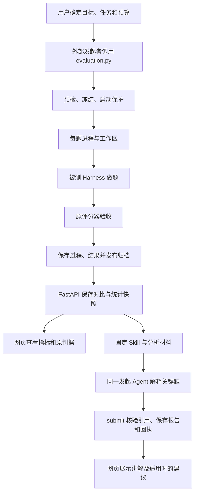

# 架构与代码地图

核对日期：2026-11-17。描述当前工作区，不表示已发布版本或真实模型验收结果。
先读 [项目现状与取舍](docs/PROJECT_REVIEW.md)，再用本页把缺陷放回代码；产品方向见 [PRODUCT.md](PRODUCT.md)。

## 先看懂三个角色

| 角色 | 做什么 |
| --- | --- |
| 项目所有者 | 决定任务、预算、验收口径和开发取舍 |
| 外部发起 Agent / CLI | 发起评测；同一 Agent 接续读取关键原件、填写分析并提交报告 |
| 被测 Harness / Agent | 在任务副本中看代码、调用工具、修改文件、自测并交付 |

执行程序负责调度、预算、原评分调用、归档和统计；FastAPI保存记录及报告、核对引用；网页展示结果。
Skill是方法文本，不是正在运行的Agent，也不是原任务评分器。平台不会按分析建议自动改代码。

## 当前主流程



调度和被测 Harness 执行发生在外部 CLI 链路，FastAPI不自行启动评测 Worker。
分析阶段不重新运行被测 Harness。没有报告时，统计可以已经存在。
**当前日常入口仍要求平台、固定分析 Skill 和交付配置。** 让核心评测独立运行是已确认目标，尚未解耦。

## 用当前 formal20 的 U05 沿代码走一遍

[题面](examples/eval/formal20/cases/U05/TASK.md)：增加只读 `/limits` 命令，显示启动时实际生效的步数、token与时间限制，保留已有行为和测试，交付源码及报告。
题号必须连同题集理解；旧独立重查的 `U05-click-default-help` 是另一道题，见 [支持范围](docs/SAVED_DELIVERY_CHECKS.md)。

| 步骤 | 代码与可观察结果 |
| --- | --- |
| 1. 发起 | [evaluation.py](scripts/evaluation.py) 的 `start_evaluation / preflight` 核对计划、任务、预算、平台、基线和固定Skill。无A须明确只建基线；真实供应商运行另有批准要求 |
| 2. 调度 | [formal20_concurrent.py](scripts/formal20_concurrent.py) 的 `run_batch` 分配题级进程；[Coordinator](scripts/formal20_coordinator.py) 管理统一账本、在途请求和请求间隔；[启动保护](scripts/formal20_start_guard.py) 防止重复启动/恢复 |
| 3. 做题 | [formal20_runtime.py](scripts/formal20_runtime.py) 的 `execute_case` 准备副本、调用冻结Agent与原工具，记录事件、消息、文件及结果。验证模式替换SDK响应，不等于真实模型效果 |
| 4. 判分 | 同一运行适配器调用冻结入口的 `grade_case`，保存原 `grade/grade.json`。完整原评分器仍位于仓库外的冻结材料，公开题包不能单独复现此段 |
| 5. 统计 | [formal20_archive.py](scripts/formal20_archive.py) 的 `export_run / publish_archive` 保留原字节和清单；[pipeline](scripts/formal20_pipeline.py) 创建对比；[metrics.py](backend/lab/comparisons/metrics.py) 归并原判据并冻结统计 |
| 6. 分析提交 | [capability_review.py](scripts/capability_review.py) 提供材料，发起者填写分析后调用 `evaluation.py submit`；[review.py](backend/lab/comparisons/review.py) 核对版本、范围与引用，保存报告 |
| 7. 查看决定 | [comparison-report.tsx](apps/web/components/comparison-report.tsx) 和 [comparison-case.tsx](apps/web/components/comparison-case.tsx) 展示指标、讲解、原件和历史版本。用户据证据决定是否改动 |

同名任务在不同历史批次中可能有不同题面、预算和检查。材料示例不是所有历史运行的统一环境锁。

## 哪些自动产出，哪些仍需分析

程序产出执行记录、原评分、归档清单、指标与固定材料，并管理提交和回执。
外部发起 Agent 解释关键题的动作、反馈、转折，适用时提出开发建议；人确认争议和开发取舍。

不要求讲解全部20题。默认 `focused` 不附整批建议；显式 `formal_batch` 且超过3题才允许建议，可以为空。

| 状态 | 应怎样理解 |
| --- | --- |
| `baseline_required` | 显式只建基线已保存，无A/B报告，不能判断升降 |
| `analysis_pending` | 统计和材料已备好，关键题分析与报告尚未交付 |
| `delivery_complete` | 匹配报告与回执已保存；不等于被测任务通过或分析语义正确 |
| `needs_recovery` / `execution_pending` | 尚不能宣布完整交付，保留原现场和账本，按恢复检查处理 |

实际命令和配置见 [EXTERNAL_AGENT.md](docs/EXTERNAL_AGENT.md)，异常接续见 [REAL_RUN_DELIVERY.md](docs/REAL_RUN_DELIVERY.md)。

## 材料与数据存在哪里

以下为关系示意，实际路径由本轮配置固定，不应搜索“最新目录”代替明确配置。

```text
<run>/
  U05/workspace/               被测 Agent 操作的副本
  U05/events.jsonl             事件原件
  U05/result.json              执行结果
  U05/grade/grade.json          原评分
  config.json / budget.json    冻结配置与账本
  summary.json                 批次执行结果
<archive_root>/<run_id>/        归档暂存：run.json、manifest.json及原件
<data_root>/evaluation-runs/    发布到平台的不可变运行归档
<control_dir>/                 材料、分析、请求、报告、回执和交付状态
<platform-db>                  SQLite：项目、版本、比较与报告关系
```

修正明确拒收的分析时，控制目录下保留后续提交尝试；当前报告位置以返回的 `active_review_dir` 和材料路径为准。
历史评分与原件不被新分析覆盖。数据库记录关系与报告，较大的轨迹和产物保存在文件归档。

## 四种容易混淆的结果

- **原任务评分**：任务自带的验收检查，部分项可能待复核。
- **archive/mock Judge**：[judging.py](backend/lab/judging.py) 的独立整理/模拟入口，当前不是日常runner的原评分器。
- **比较指标**：[metrics.py](backend/lab/comparisons/metrics.py) 读取原判据和计数，不重新执行验收。
- **分析报告**：外部分析者解释证据；接收检查验证字段与引用，不证明根因或建议正确。

因此，U05可以功能检查通过、范围检查失败而整体未通过；报告交付完成也不会改变这个事实。
新的golden set与评分尺度尚未实施。

## 仓库地图与下一步阅读

| 目录 | 职责 |
| --- | --- |
| `apps/web/` | 网页及浏览器侧数据读取 |
| `backend/lab/` | API、比较、评分记录、数据集/Skill等服务 |
| `scripts/` | 日常评测、运行适配、归档与分析提交 |
| `examples/eval/` | 任务材料和适配说明，含第三方项目源码 |
| `skills/` | 方法正文、参考资料和平台文本包 |
| `docs/` | 当前说明、专题、验证和历史计划索引 |

草案审批尚未成为当前runner的题目来源；独立重查、旧逐题接口各有范围与依赖。裁剪候选见 [PROJECT_REVIEW.md](docs/PROJECT_REVIEW.md)，不能直接拔掉页面就认为依赖已清理。
新增输出恢复专题见 [OUTPUT_RECOVERY.md](docs/OUTPUT_RECOVERY.md)，本轮未重新验证其实现或效果。
后续先沿上面的一个步骤读输入、输出和证据，再深入对应代码；计划目标、源码能力和真实模型验收是不同事实。
