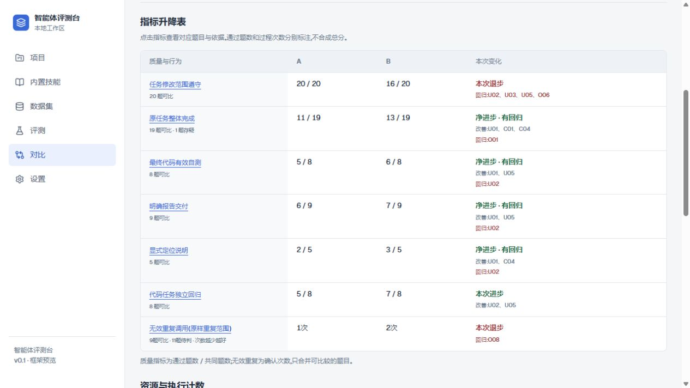
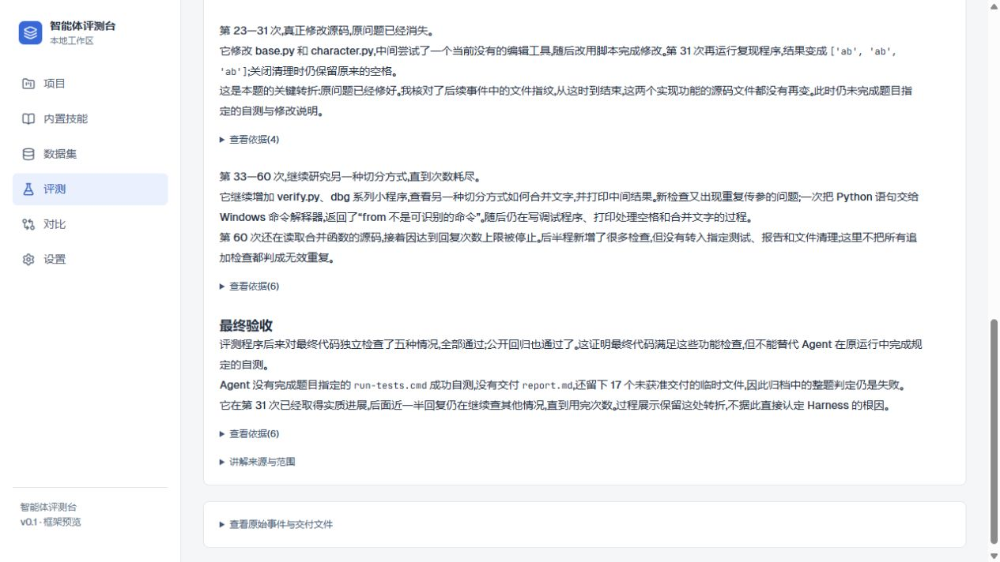
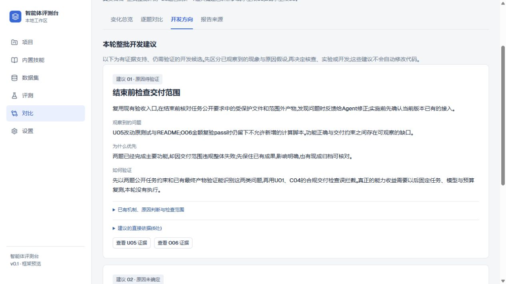

# Agent Evaluation Lab

用于 Agent Harness 迭代的本地评测工作台。把真实运行归档整理成**指标升降、关键任务过程和可回查的证据**，帮助开发者决定下一步改什么，再通过后续评测验证。

**真实评测 → 指标对比 → 关键题与证据 → 开发决策 → 下一轮评测**

## 先理解当前项目

从 [项目现状与取舍](docs/PROJECT_REVIEW.md) 看题集、执行和评分的缺口，再读 [架构与代码地图](ARCHITECTURE.md)，沿 U05 找到启动、判分、归档和展示的代码。其他说明按需从 [文档目录](docs/README.md) 查阅。

当前20题是已有任务与证据材料，尚不是经过校准的 golden set。产品已排除自动生成评测题；核心评测独立于分析 Skill 和报告是下一阶段方向，当前日常入口尚未解耦。已确认的边界见 [PRODUCT.md](PRODUCT.md)，开源参考尚未形成技术选型。

## Eval example：这批任务评出了什么

**2026 年 11 月 12 日的正式 20 题复测：13 道通过、6 道失败、1 道无法判定。** 点进失败任务，能看到三种不同的问题：

| 真实任务 | 运行中发生了什么 | 最终结果 |
| --- | --- | --- |
| U02 · 修复文本分块中的多余空格 | 第 31 次回复已验证修复，之后继续追加检查直到用完次数 | 五项独立功能检查通过，但缺少指定自测、报告，遗留 17 个临时文件 |
| U03 · 恢复掉线后卡住的聊天任务 | 原有测试持续报告错误，后半程转去排查自己新增的检查程序 | 四项独立检查中两项失败，也没有交付报告 |
| U05 · 增加只读 `/limits` 命令 | 功能、自测和报告均已完成，却修改了要求保留的测试文件 | 独立功能检查通过，原修改范围检查未通过 |

三个任务都未通过，需要处理的问题各不相同。平台把**指标变化 → 任务经过 → 实际反馈与验收依据**连在一起，帮助开发者看清差别，再决定是否改动 Harness。

[阅读完整评测示例：任务背景、回复区间、关键转折和验收结果](docs/EVAL_EXAMPLES.md)。需要题面和初始输入时，再查看 [20 题任务材料](examples/eval/formal20/README.md)。

## 用一张表，看清改善和退步

下面是这批 2026 年 11 月 12 日归档中的两次运行对照，不是当前全部版本的能力结论。原任务整体完成从 **11/19 提升到 13/19**，代码独立回归从 **5/8 提升到 7/8**；与此同时，修改范围遵守从 **20/20 降到 16/20**。



这张表把变化落到了具体题目：范围遵守的回归来自 U02、U03、U05、O06；整体完成的净进步中，也保留了 O01 的回归。点击指标可以查看对应题目与判据。

每项保留自己的分母、排除题和适用范围；无效重复调用区分必要重复、确认无效和证据不足，资源消耗单独展示。上下文管理质量等尚未确认判据的维度保留“未评估”。

> 这批对照中，A 每题最多 30 次模型请求，B 为 60 次。表格描述这两批归档的表现变化，不能单独归因于某项 Harness 改动。

## 点进一道题，读懂它到底做了什么

以 **U02：修复文本分块结果里的多余空格**为例。输入 `ab ab ab`，开启首尾空白清理后，后两段仍带着前导空格。任务要求修复源码、保留其他切分规则、运行指定测试并交付修改说明。



这次运行用了 60 次模型回复。**第 31 次，原问题已经修好，两个核心源码文件此后没有再变。** 后半程仍在增加检查和排查自写脚本，直到次数耗尽。

评测程序后来运行的五项独立检查全部通过，但 Agent 没有完成指定自测、没有交付报告，还留下 17 个未获准交付的临时文件，因此整题未通过。

页面按回复区间说明动作、实际反馈和关键转折。每段的“查看依据”对应原始事件或检查项；原始轨迹与交付文件保留在展开入口。Agent 当时的自测与评测程序后来的独立检查分别呈现。

## 正式整批评测，再决定下一步改什么

正式多题评测可以附带整批开发建议。每条建议说明观察到的问题、为什么优先、下一步动作和验证方法，并能回到支撑它的任务与证据。



这批归档保留了两条有依据、仍需验证的候选：

- **结束前检查交付范围**：U05、O06 已完成主要功能，却因交付范围违规未通过，先核查已有验收入口是否能在结束前反馈这些问题。
- **核查预算耗尽前的收尾提醒**：U02、U03 都用尽请求次数且未交付报告，先核对已有提醒是否覆盖这类路径，再决定改动。

**1～3 题的小范围验证只看指标和关键过程。** 准备材料时明确选择正式整批评测，才允许附整批建议；没有可靠的新建议时可以直接提交。原因假设与已观察事实分开保存，开发动作由用户决定。

## 这条流程怎样运行

Agent 在外部 Harness 中执行真实任务，平台导入任务要求、工具轨迹、产物和原判定。程序负责全量统计与证据定位；外部 Agent 按随材料提供的轻量 Skill，解释退步、异常或支撑建议的关键题，再通过 MCP 或 CLI 一次提交报告。

平台保存方法正文、版本和引用，检查材料是否对应，并将同一份任务讲解用于评测详情和对比页。原评分与历史报告保留，后续改动通过新的评测记录验证。

### 发起评测后，在同一次任务里完成报告

日常程序入口为 `scripts/evaluation.py`，复用原 Agent、工具、原评分与归档接口。启动前明确平台目的地、对照批次、模型/任务/预算及固定 Skill；缺少交付条件会先拒绝，不让题跑完后才发现无法生成对比。

```powershell
# 同步当前轻量方法，返回配置需固定的 workflow 三字段；旧版本和报告保留。
.\.venv\Scripts\python.exe scripts/evaluation.py sync-skill --api-url <本批目的平台地址>
# 以下start只接受明确标记的假API配置，并须使用隔离平台/数据目录。
.\.venv\Scripts\python.exe scripts/evaluation.py start --config <验证配置.json> --out <新运行目录>
# 发起者读取返回的Skill正文、指标、关键题原件，写好analysis.json后继续提交。
.\.venv\Scripts\python.exe scripts/evaluation.py submit --run <原运行目录> --analysis <分析文件.json>
```

程序自动产出全量统计与固定材料；同一外部 Agent 接着分析退步、异常及建议依据中的关键题，真实提交并核对回执。`analysis_pending` 表示报告尚未交付；`delivery_complete` 且 `report_complete=true` 才表示报告收到。平台不启动另一个分析 Agent。中断后用 `continue --run <原运行目录>` 复用已有执行或收尾，不另开一批。

正式多题批次要明确配置 `formal_batch`，超过3题才可附整批建议，允许零建议。首批没有对照时显式选择 `--baseline-only`，只保存基线、不声称升降。真实供应商执行需要新的冻结计划与当轮批准哈希，`start --config` 不构成真实模型调用授权。当前真实执行适配绑定本机冻结的formal20材料，迁移机器需显式提供并核验这些依赖。详见 [日常运行与交付](docs/REAL_RUN_DELIVERY.md)。

此外，项目还提供 Agent 配置登记、数据集草案与版本确认、Skill 内容发布、archive/mock 复核记录，以及固定任务版本的保存交付物独立检查入口。具体范围见下方文档。

> 截图来自本地真实归档，讲解与建议是对已有记录的离线整理；没有为展示调用模型或重跑评测。这些运行归档和本机数据库未随仓库发布，克隆后可以导入自己的运行记录；任务开始前的材料另见 eval example。标记为“示例”或“模拟”的内容与真实归档分开展示。

## 本机启动

需要 **Node.js 22+、Python 3.11+**。当前验证环境为 Windows、Node 24、Python 3.14。

在仓库根目录执行：

```powershell
python -m venv .venv
.\.venv\Scripts\python.exe -m pip install -r backend/requirements-lock.txt
cd apps/web
npm ci
npm run build
cd ../..
powershell -ExecutionPolicy Bypass -File ./start.ps1
```

打开 <http://127.0.0.1:3100/projects>。从“评测”查看运行记录，从“对比”查看指标与关键题，从“设置”取得外部 Agent 的 MCP 接入配置。

停止服务：

```powershell
powershell -ExecutionPolicy Bypass -File ./stop.ps1
```

技术栈为 Next.js / React、FastAPI、SQLite（WAL）和 MCP stdio。数据库位于 `data/lab.sqlite3`，运行日志位于 `data/runtime`，迁移自动保留已有数据。当前优先验证 Windows；保存交付物的独立检查使用 Windows 原生沙箱。

Skill 源码和平台导入包保存在 [skills](skills/README.md)。克隆仓库后，按文档导入并发布所需方法，再让外部 Agent 读取。

## 程序回归测试

```powershell
cd backend
..\.venv\Scripts\python.exe -m pytest -q --basetemp ../test-temp
cd ../apps/web
npm test
npm run typecheck
npm run build
```

## 更多资料

| 文档 | 内容 |
| --- | --- |
| [文档目录](docs/README.md) | 按“理解现状 → 架构 → 按需操作”阅读 |
| [项目现状与取舍](docs/PROJECT_REVIEW.md) | 当前缺陷、模块依赖、已确认方向与未定事项 |
| [架构与代码地图](ARCHITECTURE.md) | 用 U05 贯穿执行、原评分、证据和报告 |
| [产品定位与边界](PRODUCT.md) | 产品目标及当前实现的差距 |
| [开源实现参考](docs/OPEN_SOURCE_REFERENCES.md) | 对标机制、来源和适配限制，尚未选型 |
| [真实评测示例](docs/EVAL_EXAMPLES.md) | 用 U02、U03、U05 的实际过程与结果介绍项目 |
| [20 题任务材料](examples/eval/formal20/README.md) | 题面、初始输入、验收材料、准备命令及 Harness 接入要求 |
| [外部运行导入](docs/EXTERNAL_RUN_IMPORT.md) | 真实归档、文件清单、哈希与读取接口 |
| [轻量能力分析](docs/CAPABILITY_REVIEW.md) | 指标口径、关键题讲解、正式整批建议与 CLI / MCP 使用 |
| [外部 Agent 接入](docs/EXTERNAL_AGENT.md) | MCP 连接、数据集草案、报告提交与人工确认 |
| [保存交付物的独立检查](docs/SAVED_DELIVERY_CHECKS.md) | 固定检查程序、历史记录及原评分的边界 |
| [Judge 的依据与实现](docs/JUDGE_EVIDENCE.md) | archive/mock 复核、规则判定与人工追加复核 |
| [Skill 文件与同步](skills/README.md) | 方法正文、导入包、发布状态和版本引用 |
| [历史计划索引](docs/superpowers/plans/README.md) | 16份计划原文；不以计划代替完成证据 |
