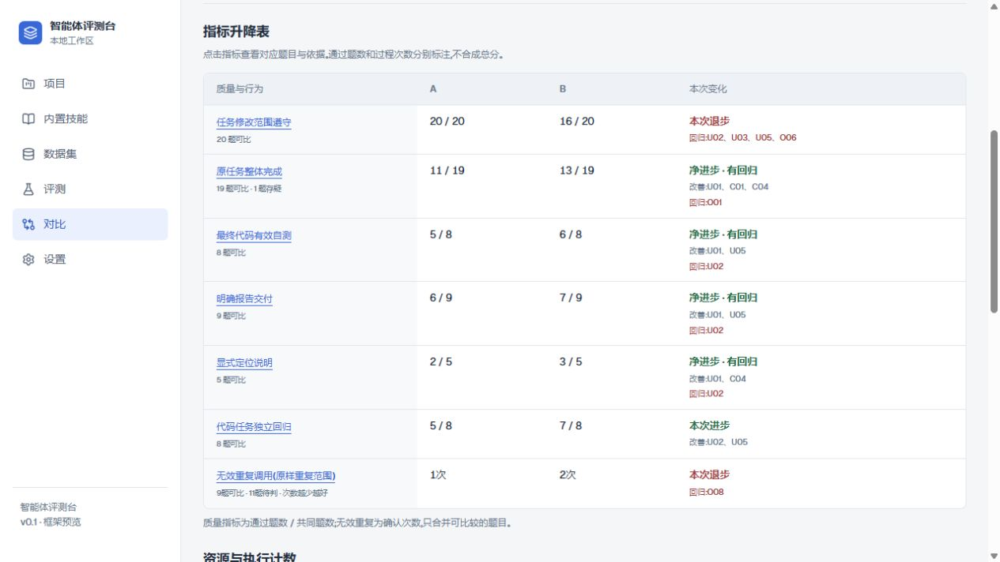
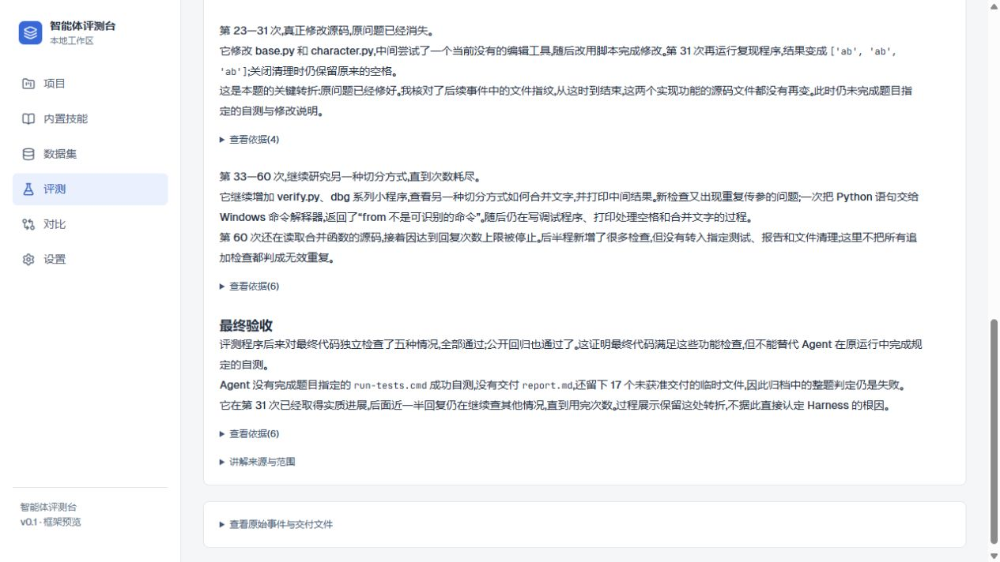
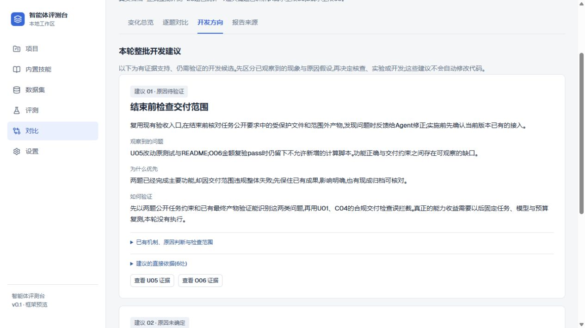

# Eval example：一次真实的 20 题复测

Agent Evaluation Lab 怎样帮助迭代 Harness？下面用 **2026 年 11 月 12 日完成的正式 20 题复测**说明。这批有 13 道通过、6 道失败、1 道无法判定。题号只用于标识这一批任务，阅读其他批次时还需核对任务名。

先看两次归档的指标变化，再看三道失败题的实际过程，最后决定哪些问题值得继续核查。本页的过程是对已有真实归档的离线整理，没有为示例调用模型、重跑评测或改写原评分。

## 指标：哪些方面改善，哪些方面退步



两次归档中，原任务整体完成从 **11/19 到 13/19**，代码任务独立回归从 **5/8 到 7/8**；修改范围遵守却从 **20/20 降到 16/20**。表格保留每项的可比题数和具体改善、回归题，不合成一个总分。

这些数字描述的是两批归档的表现。A 每题最多 30 次模型请求，B 为 60 次，其他运行条件也有变化，不能据此认定某一项 Harness 改动带来了稳定提升。

接下来三道题都未通过，但原因不同。下文区间按“模型第几次回复”计算，一次回复可能包含多个操作；不能直接当作工具调用序号。

## U02：代码已修好，后半程继续追加检查，最后没完成交付

任务给出一份现成的文字处理库源码。输入 `ab ab ab`，要求切成三段并清理首尾空格，预期为：

```text
ab
ab
ab
```

实际后两段前面仍有空格。Agent 需要修复这个问题，保留其他切分规则，运行指定检查，并写修改说明。

这次用了 **60 次回复，约 3 分 46 秒**：

- **第 1—13 次：查代码并复现。** 查看测试和空格处理代码，写小程序，确认后两段有多余空格。
- **第 14—20 次：扩大检查范围。** 新写的检查程序先出现参数和调用方式错误，这几次主要在修自己的程序。
- **第 23—31 次：修改源码并验证原问题。** 第 31 次回复已验证三段内容正确，关闭空白清理时也保留了原空格。从这次验证到结束，两个核心源码文件没有再变。
- **第 33—60 次：继续研究另一种切分方式。** 反复写小程序、打印中间结果，排查的某个表现其实在修改前就存在，直到次数耗尽。

**最终验收：五项独立功能检查全部通过；缺少题目指定的那次自测和修改说明，并留下 17 个未获准交付的临时文件，整题未通过。**



这道题让开发者看见：功能修复已经取得实质进展，后续却没有收敛到题目要求的交付。它是否由预算提醒、结束检查或其他机制导致，还需要核查，轨迹本身不能直接证明根因。

## U03：原有检查仍失败，后来忙于排查自己新增的检查程序

聊天页面正在等待用户回答，后台 worker 已经退出。用户提交后，旧任务结束不了，新一轮也开始不了。

Agent 要在发现 worker 失效时拒绝这次回答，结束旧任务、持久化失败状态并通知页面，让用户可以继续聊天；重复提交不能重复发送终止事件。

这次用了 **60 次回复，约 7 分 12 秒**：

- **第 1—8 次：找到并复现故障。** 原有检查明确报告旧任务仍停在“等待输入”。
- **第 9—34 次：沿调用链读代码。** 查看接收回答、记录状态和发送通知的流程。
- **第 37—39 次：首次修改并检查。** 检查仍失败：本应拒绝回答，程序却返回接收成功。改动把“清理旧任务成功”直接当成了“接收回答成功”。
- **第 40—46 次：继续修改。** 再查状态保存和通知代码，但同一个检查仍未通过。
- **第 47—59 次：排查新增检查程序。** 先遇到依赖缺失，换解释器后又出现长时间等待，随后加打印、查启动过程。
- **第 60 次：按原测试的启动方式重写新增程序。** 尚未再次运行，就达到次数上限。

**最终验收：四项独立检查通过两项、失败两项，也没有修改说明。**

与 U02 相比，这里的核心功能仍然有明确失败反馈。读懂过程后，开发者可以进一步核查：为什么原有检查已经指出错误，后半程仍投入了大量精力处理新增检查程序。

## U05：功能与验证完成，修改范围没有守住

终端程序需要新增只读 `/limits` 命令，显示会话实际使用的步数、Token 和时间限制。查询不能请求模型或保存会话，还要保留已有测试。

这次用了 **36 次回复，约 2 分 31 秒**：

- **第 1—12 次：查看入口和设置。** 确认原程序会把 `/limits` 当普通聊天内容发给模型。
- **第 13—16 次：实现命令，原有检查通过。** 中途遇到 Windows 不支持的命令写法，换方法后继续完成。
- **第 18—19 次：追加测试并运行。** 把六个新检查写进原测试文件，七项检查通过；但原文件被题目要求保留。
- **第 20—29 次：从终端入口再验证。** 修正自写程序后，检查默认、自定义以及“显式值恰好等于默认值”的情况。
- **第 32—36 次：更新说明、写报告、再次检查并结束。** README 的修改也被原范围检查记为越界。

**最终验收：Agent 自己的七项检查和评测程序的四项独立检查均通过，报告也已交付；因修改原测试文件及 README，原修改范围检查未通过。**

这道题的功能和收尾已经完成。若只看功能测试，会漏掉范围问题；若只看整体失败，又会看不到已完成的功能、自测和报告。这里记录原验收结论，不把范围检查失败推断为实现功能失败。

## 怎样进入下一轮开发

这三道题帮助区分了不同现象：U02 修复后未收敛交付，U03 功能错误尚未解决，U05 交付范围违规。开发者可以沿证据核查现有机制，再选择改动，随后用新的真实运行验证。

平台自动统计所有题的指标，外部分析者只解释退步、异常或支撑开发判断的关键题。**1～3 题的小范围验证只看指标和关键过程；正式多题评测才可附整批开发建议，有依据时再提出。** 建议不是对某个模块的自动定责，也不会自动改代码。



本批已有的候选包括：核查结束前的交付范围检查，以及预算耗尽前的收尾提醒。它们是根据已观察结果提出的核查方向，尚不能当成已确认的根因或实施方案。

## 继续查看

- [项目 README](../README.md)：工作台介绍、截图和本机启动。
- [这 20 道题的题面和初始输入](../examples/eval/formal20/README.md)：了解 Agent 开始时拿到的任务与材料。该包是 11 月 15 日导出后的示例，不是历史运行环境锁文件。
- [U05 的离线讲解记录](../examples/capability-review/u05-explanation-offline.json)：查看结构化的关键过程、依据定位和候选建议。
- [轻量能力分析](CAPABILITY_REVIEW.md)：指标统计、材料读取、关键题讲解与报告提交方式。

原始运行归档和本机数据库没有随仓库公开。本页引用的是该批真实归档的过程与原验收结论；公开截图和讲解不等于读者克隆仓库后能够独立复算全部历史证据。
